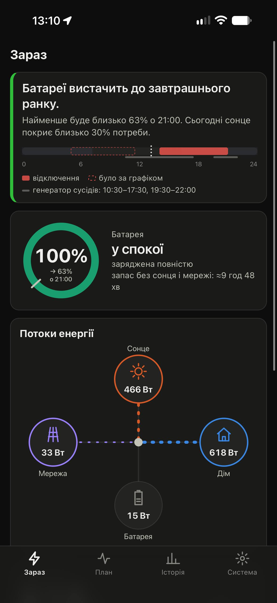
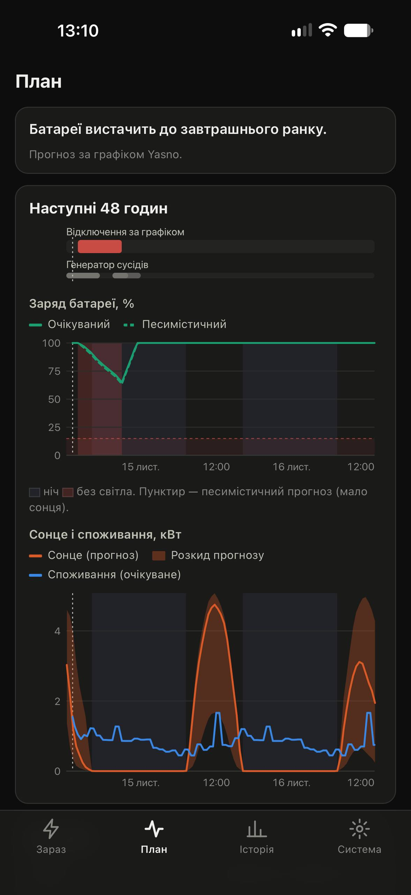
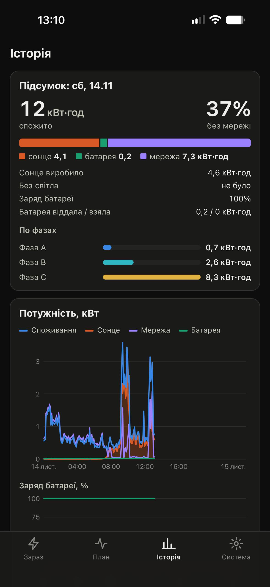
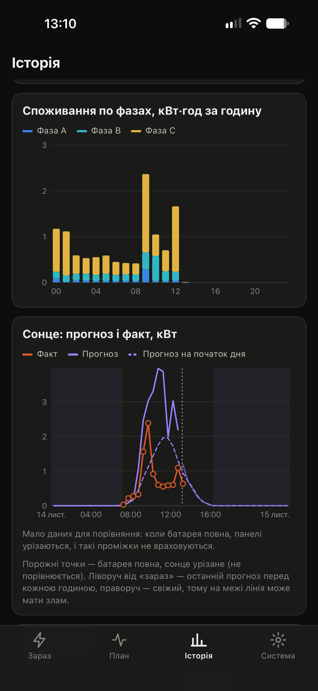

# Deye Dashboard

Вебзастосунок (PWA) для гібридного інвертора **Deye**: що зараз відбувається з батареєю, сонцем і мережею, чи
вистачить заряду до повернення світла, графік відключень Yasno, прогноз сонця і історія споживання.
Встановлюється на телефон як звичайний застосунок, працює на iPhone і Android, надсилає сповіщення.

Усе працює на безкоштовному тарифі Cloudflare і маленькому одноплатному комп'ютері (Raspberry Pi, Orange Pi тощо)
вдома. Хмара Solarman і будь-які сторонні сервіси для даних інвертора не потрібні.

<table>
  <tr>
    <td></td>
    <td></td>
    <td></td>
    <td></td>
  </tr>
  <tr>
    <td align="center">Зараз</td>
    <td align="center">План на 48 годин</td>
    <td align="center">Історія: підсумок дня</td>
    <td align="center">Історія: фази, сонце</td>
  </tr>
</table>

## Що вміє

- **Зараз.** Одне речення про головне («Батареї вистачить до завтрашнього ранку»), заряд батареї, потоки енергії
  між сонцем, мережею, батареєю і домом, споживання загалом і по трьох фазах, смуга дня з відключеннями.
- **План на 48 годин.** Прогноз заряду батареї (очікуваний і песимістичний), коли батарея сяде або зарядиться, скільки
  ват треба зекономити, щоб дотягнути до світла. Враховує графік Yasno, прогноз сонця Solcast і типове
  споживання вашого дому за останні тижні.
- **Історія.** День, тиждень, місяць: споживання по фазах, скільки дало сонце, батарея і мережа, частка автономності,
  журнал реальних відключень поруч із графіком, прогноз сонця проти факту.
- **Сповіщення** (Web Push): світло зникло або повернулося, батареї не вистачить, низький заряд, змінився графік,
  скоро відключення, дані не надходять. Кожен користувач вмикає потрібні сам, є «тихі години».
- **Кілька користувачів.** Вхід за email через Cloudflare Access. У кожного свої налаштування, наприклад показувати
  лише свою фазу.
- **Home Assistant** (за бажанням): готовий пакет сенсорів і дашборд, див. [docs/home-assistant.md](docs/home-assistant.md).

Застосунок лише показує дані й радить. Керувати інвертором він не може.

## Як це влаштовано

```
Інвертор Deye ── Wi-Fi логер Solarman ──Wi-Fi── роутер ──LAN── Pi (pusher) ──HTTPS──▶ Cloudflare Worker + D1 ◀── телефон
```

- **Pusher** (`pi/pusher/`): невеликий Python-сервіс на Pi. Кожні 30 с читає регістри інвертора через Wi-Fi логер
  (протокол Solarman V5, порт 8899) і відправляє їх у хмару. Якщо інтернету немає, тримає до доби даних у пам'яті й
  дошле пізніше.
- **Хмара** (`cloud/`): один Cloudflare Worker. Приймає дані, розшифровує регістри, зберігає все в базі D1, раз на
  15 хвилин забирає графік Yasno і прогноз Solcast, рахує прогноз заряду, шле сповіщення і віддає сам застосунок.
- **Вхід** захищає Cloudflare Access: застосунок бачать лише ті email-адреси, які ви дозволили.

Розшифровка регістрів живе в хмарі, тож Pi достатньо налаштувати один раз. Виправлення й нові функції ставляться
простим `deploy` у Cloudflare.

## Що потрібно

| Що | Примітки |
|---|---|
| **Інвертор Deye**, трифазний низьковольтний гібрид (`SUN-*K-SG0*LP3`, напр. SUN-10K-SG04LP3-EU) | Перевірено на SUN-10K-SG04LP3-EU. В інших моделей (однофазні, високовольтні) інша карта регістрів, тож треба правити `cloud/src/decode.ts` |
| **Wi-Fi логер Solarman** в інверторі (LSW-3 або схожий) | Має бути в домашній мережі. Потрібні його IP і серійний номер (10 цифр, з наліпки на логері). Логер і далі може слати дані в Solarman Cloud |
| **Raspberry Pi / Orange Pi / будь-який Linux** у тій самій мережі, 24/7 | Python 3.9+. Вистачить найслабшого Pi. Краще живити його від інвертора (резервна лінія), щоб дані йшли й під час відключень |
| **Акаунт Cloudflare** (безкоштовний) і **власний домен** у ньому | Застосунок відкривається на піддомені, напр. `deye.example.com`. Домен потрібен, щоб закрити застосунок входом (Cloudflare Access), а адресу для Pi лишити відкритою |
| **Node.js 22+** на вашому комп'ютері | Для `wrangler` (розгортання в Cloudflare) |
| Акаунт **Solcast** (безкоштовний, за бажанням) | Прогноз сонця. Без нього все працює, просто без прогнозу |
| Адреса в зоні **Yasno** (Київ, ДТЕК Київські електромережі) | Графік відключень. В інших регіонах графіка не буде, решта працює |

Час і тексти розраховані на Україну: часовий пояс Europe/Kyiv, інтерфейс українською.

## Встановлення

### 1. Отримайте код

Зробіть **fork** цього репозиторію на GitHub (і поставте ⭐, будь ласка), потім склонуйте свій fork:

```sh
git clone https://github.com/<ваш-логін>/deye-dashboard.git
cd deye-dashboard/cloud
npm install
```

### 2. Cloudflare

Усі команди нижче виконуються в папці `cloud/`.

1. **Увійдіть у wrangler:** `npx wrangler login`. Якщо у вас кілька акаунтів Cloudflare, замість логіну створіть API-токен
   (My Profile → API Tokens → шаблон *Edit Cloudflare Workers* + дозвіл *Account › D1 › Edit*) і експортуйте
   `CLOUDFLARE_API_TOKEN` і `CLOUDFLARE_ACCOUNT_ID`.
2. **Створіть базу:** `npx wrangler d1 create deye` і скопіюйте `database_id` з відповіді.
3. **Конфіг:** `cp wrangler.example.jsonc wrangler.jsonc` і заповніть у `wrangler.jsonc`:
   - `account_id`: ID акаунта (dashboard → Workers & Pages, праворуч);
   - `routes` → `pattern`: ваш піддомен, напр. `deye.example.com` (домен має бути в цьому акаунті Cloudflare);
   - `database_id`: з кроку 2.

   `ACCESS_*` поки не чіпайте. Файл `wrangler.jsonc` у `.gitignore`, ваші ID не потраплять у git.
4. **Таблиці:** `npm run migrate:remote`
5. **Ключ для Pi:** згенеруйте `openssl rand -hex 32`, збережіть його (знадобиться для Pi) і додайте у Worker:
   `npx wrangler secret put PUSH_KEY`
6. **Розгорніть:** `npm run deploy`. Поки Access не налаштований, сайт відповідає `503 Access not configured`, і це
   нормально: Worker нікого не пускає без входу.
7. **Cloudflare Access** (вхід за email). Dashboard → **Zero Trust**. Першого разу виберіть назву команди (team name)
   і план **Free** (до 50 користувачів безкоштовно, але попросить картку). Далі Access → Applications →
   **Add an application → Self-hosted**:
   - домен: ваш піддомен (`deye.example.com`), шлях порожній;
   - policy: **Allow**, Include → *Emails* → адреси всіх, кому можна дивитися;
   - Session duration: **1 month**, щоб застосунок на телефоні не просив входити щотижня;
   - вхід: *One-time PIN* (код на пошту) підходить.

   Потім **друга** аплікація Self-hosted для `deye.example.com` зі шляхом **`/api/ingest`** і policy з дією
   **Bypass** → Include *Everyone*. Сюди ходить Pi, його захищає `PUSH_KEY`.
8. Відкрийте першу аплікацію → Overview і скопіюйте **Application Audience (AUD) Tag**. У `wrangler.jsonc` впишіть
   `ACCESS_AUD` і `ACCESS_TEAM_DOMAIN` (`https://<team>.cloudflareaccess.com`). Знову `npm run deploy`.

Тепер `https://deye.example.com` просить email, пускає вас і показує застосунок без даних.

#### За бажанням: прогноз сонця (Solcast)

1. Зареєструйтеся на [solcast.com](https://solcast.com/) як *Home User* (безкоштовний hobbyist-план) і додайте свій дах
   (Rooftop site): координати, потужність панелей, нахил, азимут.
2. Скопіюйте API key (Account → API Key) і **Resource Id** даху.
3. `npx wrangler secret put SOLCAST_API_KEY` і `npx wrangler secret put SOLCAST_RESOURCE_ID`.

Безкоштовно Solcast дає 10 запитів на добу. Worker робить 8 у світлий час і веде облік у базі, тож ліміт не перевищить.

#### За бажанням: сповіщення (Web Push)

```sh
node test/gen-vapid.mjs                        # друкує VAPID_PUBLIC_KEY і VAPID_PRIVATE_KEY
npx wrangler secret put VAPID_PUBLIC_KEY
npx wrangler secret put VAPID_PRIVATE_KEY
npx wrangler secret put VAPID_SUBJECT          # mailto:ваша@пошта
```

### 3. Pi: pusher

Підготуйте Pi з будь-яким Debian-подібним Linux (Raspberry Pi OS Lite, Armbian) і доступом по SSH.

1. **Логер:** у роутері закріпіть за Wi-Fi логером інвертора постійну IP-адресу (DHCP reservation). Серійний номер
   логера є на його наліпці (10 цифр; це **не** серійник інвертора).
2. **Встановіть pusher:**
   ```sh
   sudo apt update && sudo apt install -y git python3-venv
   sudo git clone https://github.com/<ваш-логін>/deye-dashboard.git /opt/deye-dashboard
   cd /opt/deye-dashboard/pi/pusher
   sudo python3 -m venv .venv
   sudo .venv/bin/pip install -r requirements.txt
   sudo useradd --system --shell /usr/sbin/nologin deye-pusher
   ```
3. **Налаштування:**
   ```sh
   sudo cp push.env.example push.env
   sudo nano push.env
   ```
   Впишіть `PUSH_URL=https://deye.example.com/api/ingest`, `PUSH_KEY` (той самий, що в кроці 2.5),
   `INVERTER_IP` і `INVERTER_SERIAL` логера. Потім:
   ```sh
   sudo chown deye-pusher push.env && sudo chmod 600 push.env
   ```
4. **Перевірка вручну** (Ctrl+C, щоб зупинити):
   ```sh
   sudo -u deye-pusher .venv/bin/python -u standalone.py
   ```
   Має з'явитися `connected to the logger …`, а за хвилину у вкладці **Система** застосунку видно свіжі дані.
5. **Автозапуск:**
   ```sh
   sudo cp deye-pusher.service /etc/systemd/system/
   sudo systemctl enable --now deye-pusher
   journalctl -u deye-pusher -f        # лог
   ```

Pusher пише в лог лише зміни стану («send failing», «ok again»), а помилки показує в застосунку
(**Система → Стан системи**). Годинник Pi може бути неправильним після перезавантаження: час кожного виміру рахує хмара.

Оновлення pusher (потрібне рідко):
`cd /opt/deye-dashboard && sudo git pull && sudo systemctl restart deye-pusher`.

### 4. Перший запуск

1. Відкрийте застосунок і перейдіть у **Система → Спільні налаштування**:
   - **наша адреса** (вулиця і будинок) для графіка Yasno; черга визначиться сама;
   - **назви фаз** («Кухня», «Другий поверх» …);
   - **батарея**: ємність у кВт·год і заряд, на якому інвертор вимикається (за замовчуванням 20 кВт·год і 15%).
   Друга адреса, «Сусіди з генератором», показує години, коли в сусідів працює генератор (їхні відключення з 07:00 до 22:00).
   Якщо вам це не потрібно, залиште її порожньою.
2. **Встановіть на телефон.**
   iPhone: Safari → Поділитися → «На початковий екран», далі відкривайте з іконки.
   Android: Chrome → ⋮ → «Встановити застосунок».
3. **Сповіщення:** у застосунку, встановленому на телефон, відкрийте **Система** → «Увімкнути сповіщення на цьому
   пристрої» і виберіть потрібні типи (iPhone: iOS 16.4+, лише з іконки на початковому екрані).

Прогноз точнішає з часом: типове споживання береться з історії, тож перші кілька днів він приблизний.

## Оновлення

Щоб забрати нові зміни з цього репозиторію у свій fork:

```sh
git remote add upstream https://github.com/egrudina/deye-dashboard.git   # один раз
git pull upstream main
cd cloud && npm install && npm run migrate:remote && npm run deploy
```

Ваш `wrangler.jsonc` і секрети не в git, тож конфліктів з ними не буде.

## Розробка

```sh
cd cloud
cp .dev.vars.example .dev.vars
npm run migrate:local
npm run dev                        # http://localhost:8787, без входу (DEV_NO_AUTH=1)
node test/seed-local.mjs           # тестові дані в локальну базу (у другому терміналі)
npm test                           # юніт-тести
npm run check                      # TypeScript
```

Фейковий інвертор для тестів pusher без справжнього заліза: `python3 tools/fake_inverter.py`
(Solarman V5 на `127.0.0.1:8899`). Pusher до нього: `INVERTER_IP=127.0.0.1` у `push.env`.

## Структура

| Папка | Що там |
|---|---|
| `cloud/` | Cloudflare Worker (TypeScript), міграції D1, вебзастосунок без збірки (`cloud/web/`) |
| `pi/pusher/` | Pusher: `standalone.py` (звичайний режим), `pusher.py` (ядро), systemd-юніт |
| `ha/` | Пакет і дашборд для Home Assistant |
| `tools/` | Фейковий інвертор і тести pusher |
| `docs/` | Технічна документація (англійською): [архітектура](docs/architecture.md), [Cloudflare](docs/cloudflare-setup.md), [Home Assistant](docs/home-assistant.md), [план v2](docs/dashboard-v2-plan.md) |

Деякі файли в `docs/`, `tools/card.sh` і `backup/` описують особливу установку автора: там pusher живе всередині
вже наявного процесу на Pi, а доступу по SSH немає. Для звичайного встановлення вони не потрібні.

## Ліцензія

[MIT](LICENSE). Користуйтеся як завгодно: ставте вдома, змінюйте, переробляйте, використовуйте в своїх проєктах,
зокрема комерційних. Єдине прохання: якщо проєкт вам знадобився, **поставте ⭐ репозиторію**. Мені буде приємно,
а іншим легше його знайти.

Знайшли помилку або маєте ідею? Відкривайте issue чи pull request.

Проєкт не пов'язаний з Deye, Solarman, Yasno, ДТЕК чи Solcast. Назви належать їхнім власникам.
